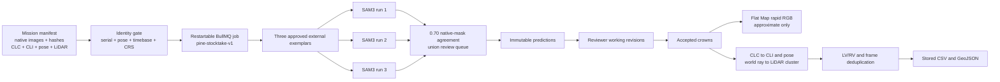

# Pine Stocktake v1 architecture

Pine Stocktake is an auditable workflow inside `/orthomosaics`. It does not change the existing SAM3, YOLO, single-image upload, annotation, or review workflows.

## Fixed identities

- Method: `pine-stocktake-v1`.
- Model: `facebook/sam3` at revision `3c879f39826c281e95690f02c7821c4de09afae7`.
- Weight SHA-256: `6d06f0a5f84e435071fe6603e61d0b4cc7b40e0d39d487cfd4d67d8cc11cc14a`.
- Flat Map Runner base: `707ab72ffe90632f257fcdcaac9f357dba193b0b`.
- Validated local runner commit: `824cf071c7220f831cf3352111a43caddf8f25c8`.
- Validated runner tree archive SHA-256: `6c35112fe4c0b70d8018f3133ac562e3e9ca37f64cbaa970e48e624c17ab337d`.

The worker checks each configured backend `/identity` response before it submits work. Missing or different identities block the stage. It does not fall back to DINOv2, YOLO, Roboflow, or a different SAM backend.

The added SAM3 service lane is `/api/v1/pine-stocktake`. Set `PINE_STOCKTAKE_SAM3_URL` to that full base path and set `PINE_SAM3_MODEL_DIR` on the service to the local pinned revision directory. The service hashes `model.safetensors` before it reports ready. It reads native target and exemplar bytes by signed URL, verifies each image hash, runs all tiles for one exemplar before the next exemplar, and returns immutable runs, candidates, RLE masks, duplicate lineage, and agreement groups.

`PINE_FLAT_MAP_RUNNER_URL` is the job wrapper for the validated Windows runner. It must return all seven output artifacts with SHA-256 values and the exact commit and runner-tree hash. `PINE_STOCKTAKE_LIDAR_URL` is the calibrated mapping worker. Its identity must be `image-clc-cli-pose-lidar-v1`. It must verify raw input hashes and return exactly one matched association or explicit missing reason for every accepted crown. There is no in-process substitute when either backend is absent.

## Cross-image detection contract

Each target image uses three approved full-crown exemplars from other images. Each exemplar runs independently. Target annotations are forbidden from the prompt set. Native 6144 by 4096 pixels remain unchanged and are covered by 1024 by 1024 tiles at 768-pixel stride. Boundary input smaller than a tile stays partial and is not stretched.

The shared canvas is 1008 by 1008 pixels. The support band is 252 pixels high. The query area is 756 pixels high. Score and mask thresholds are 0.50. Exact native-mask IoU 0.70 removes within-exemplar duplicates and groups cross-exemplar agreement. The one-of-three, two-of-three, and three-of-three result is evidence. The full union enters review.

## Persistence boundaries

`PineCandidate` and `PineInferenceRun` are immutable model evidence. The review API has no candidate update operation. `PineReviewRevision` stores working, rejected, unsure, edge-clipped, added-missed, and accepted decisions. `PineAcceptedCrown` stores the final polygon and its revision, exemplar, score, image-hash, and reviewer lineage.

The other logical records are `PineStocktakeJob`, `PineMissionFile`, `PineExemplar`, `PineAgreementGroup`, `PineDuplicateGroup`, `PineFlatMapResult`, and `PineLidarAssociation`. The migration is additive and uses existing project, team, user, asset, and orthomosaic ownership.

## Mapping contract

The accepted coordinate path is:

`native image pixel -> camera ray -> flight CLC -> LiDAR frame -> CLI and matched pose -> projected world coordinate -> coherent LiDAR crown cluster`

Flat Map coordinates never enter this path. Flat Map is a rapid RGB preview, navigation, and comparison layer. The UI labels its positions as approximate.

Direct mask support runs first. Strict cross-view duplicate replay runs second. A calibrated ray search then uses 0.15 to 2.30 metre HAG, vegetation classes 3, 4, and 5, and a 0.75 metre radius. Existing accepted stock uses a 0.50 metre duplicate radius. A new bounded cluster requires review. No cluster produces an explicit missing-height reason, never an invented coordinate.

The main height is P99 ground-normalized height. The highest valid crown point, local ground elevation, point count, and match confidence remain separate evidence.

## Restart and failure behaviour

The `pine-stocktake-v1` BullMQ queue has deterministic stage IDs. Re-submission returns the active or completed job. A failed queue item can be removed and submitted again with the same idempotency key. The database `restartState` prevents a completed stage from duplicating records. Review revisions remain independent of stage retries.

Precise mapping stops with an explicit reason for model drift, missing backend identity, camera serial mismatch, missing pose identity, timebase mismatch, unknown or inconsistent CRS, absent accepted crowns, or absent bounded LiDAR support.
